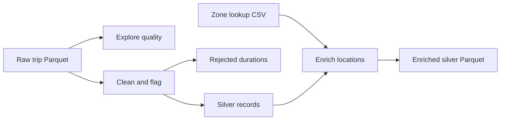

<div align="center">


# NYC Mobility

**Turn taxi records into a clearer data story.**


[Overview](#overview) &nbsp; · &nbsp; [Local setup](#prepare-a-local-run) &nbsp; · &nbsp; [Explore the repository](https://github.com/mcampo0215/nyc-mobility-data-platform)

</div>

---

## Overview

A work-in-progress NYC taxi data pipeline that explores trip records, separates negative-duration trips, flags suspicious values, and enriches cleaned records with pickup and drop-off taxi-zone information.

| Explore | Clean | Enrich |
| :--- | :--- | :--- |
| Inspect schema, missing values, invalid values, and trip outliers. | Separate negative-duration records and preserve quality flags. | Join pickup and drop-off locations with borough and zone names. |

## Pipeline



## Prepare a local run

Install Python, a Java runtime compatible with your PySpark version, and the Python dependencies. PySpark is imported by the transformation scripts but is not listed in the current `requirements.txt`, so install it separately:

```sh
python -m venv .venv
```

Activate the environment for your shell, then:

```sh
python -m pip install -r requirements.txt
python -m pip install pyspark
```

Provide these input files under the repository root:

```text
data/raw/yellow_tripdata_2024-01.parquet
data/reference/taxi_zone_lookup.csv
```

The ingestion script is currently incomplete: `DATA_URL` repeats the host/path instead of selecting a Parquet file, and the completion message references `OUTPUT_FIILE` rather than `OUTPUT_FILE`. Correct those two lines before using it, or place the source data at the paths above. This documentation update does not modify pipeline code.

Once the inputs are ready, run from the repository root:

```sh
python src/transformation/explore_data.py
python src/transformation/clean_taxi_data.py
python src/transformation/enrich_taxi_data.py
```

## Outputs and quality rules

| Output | Contents |
| :--- | :--- |
| `data/silver/yellow_taxi_2024_01` | Records with nonnegative trip duration, computed duration/speed, and quality flags. |
| `data/rejected/yellow_taxi_2024_01` | Negative-duration records. |
| `data/silver/yellow_taxi_enriched_2024_01` | Silver records with pickup/drop-off borough and zone fields. |

The cleaner flags negative fares, missing passenger counts, speeds above 100 mph, and durations above 180 minutes. These flags do not mean all such rows are removed. Writes use overwrite mode. Gold-layer aggregation, orchestration, and a deployed dashboard are not implemented in this snapshot.

## Source map

- [Ingestion](src/ingestion/download_taxi_data.py)
- [Quality exploration](src/transformation/explore_data.py)
- [Cleaning](src/transformation/clean_taxi_data.py)
- [Zone enrichment](src/transformation/enrich_taxi_data.py)

---

<p align="center"><a href="#nyc-mobility">Back to the top</a></p>
